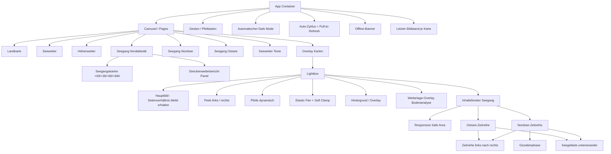

## UI-Struktur

> Stand: Release-1.9. US-030 (Seegang Nordatlantik mit Streckenwetterbericht)
> ist abgeschlossen. Die Story-Historie steht im [Backlog](backlog.md).

Die Oberfläche zeigt ruhige, bildschirmfüllende Wetterkarten ohne sichtbares
Menü mit natürlicher Navigation und automatischem Dark Mode.

- Carousel mit sieben Seiten: Landkarte, Seewetter, Höhenwetter, Seegang
  Nordatlantik, Seegang Nordsee, Seegang Ostsee und Seewetter Texte.
- Navigation per Swipe, Pfeiltasten und Edge-Tap; Aktualisierung über den
  automatischen Datenzyklus (Seegangskarten gemeinsam ~07/~19 UTC) und
  Pull-to-Refresh.
- Lightbox: Karten werden anhand ihrer intrinsischen Abmessungen in den
  Viewport eingepasst und behalten ihr Seitenverhältnis auch beim Zoomen;
  elastisches Pan- und Zoom-Verhalten mit Snap-Back, subtile Peek-Nachbarn und
  zyklische Bildnavigation.
- Gezoomte Bodenanalyse: Wetterlage-Overlay mit scrollbarem DWD-Text und
  Stand-Hinweis.
- Seegang-Lightboxen Nordsee und Ostsee: gemeinsames Inhaltsfenster mit
  getrennten Zeitreihen (Wind, Böen, Welle, Wetter), initial eingeklappt und
  unabhängig scrollbar; Safe-Area-Insets werden berücksichtigt. Die
  Gezeitenphase (Sp/Mt/Np auf schmalen Displays) erscheint nur in der
  Nordsee-Zeitreihe.
- Seite Seegang Nordatlantik: vier Seegangskarten (+00/+36/+60/+84h) und ein
  Panel mit dem Streckenwetterbericht Englischer Kanal bis Kanarische Inseln.
  Die Zeitreihe ordnet die Berichtswerte den UTC-Zeitpunkten zu, markiert
  Kartenhorizonte und den aktuellen Zeitpunkt; die variable Wetterlage ist
  einklappbar und wird bei kleinen Displays initial kompakt dargestellt.
- Offline: Der letzte erfolgreiche Bildstand je Karte bleibt sichtbar, auch
  nach Resize- oder Orientation-Änderungen; ein Offline-Banner zeigt den
  Zustand an.
- Mobiltelefon-Portrait (Viewports bis 767 px): Die Startseite zeigt sechs
  Karten – die beiden sichtbaren Europa-+36h-Karten stehen rechts neben der
  Bodenanalyse, die drei unteren Wetterkarten in drei gleich breiten Spalten.
  Auf der Seewetter- und Höhenwetter-Seite sind je Zeile nur die ersten beiden
  Karten sichtbar. Im Landscape bleiben alle Karten erhalten.

