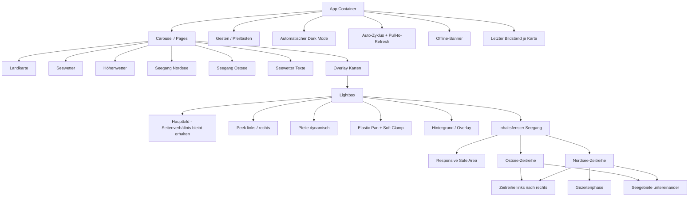

## UI-Struktur

> Teststatus (2026-10-10): Die manuelle UI-Prüfung für US-027 auf iPhones, iPads und Android-Geräten war erfolgreich.

> Release 1.0: Fokus auf ruhige, bildschirmfüllende Wetterkarten ohne sichtbares Menü, mit natürlicher Navigation und automatischem Dark Mode.
> Update US-009: Die Lightbox zeigt subtile Peek-Nachbarn und nutzt zyklische, weiche Bildnavigation mit elastischem Pan- und Snap-Back-Verhalten.
> Update US-010: Zoom- und Pan-Interaktion sind elastisch und kehren weich in den Ausgangszustand zurück.
> Update US-011: Der Carousel enthält eine zusätzliche Seite für Seegang Nordsee mit zweizeiligem Kartenlayout.
> Update US-012: Der Carousel enthält eine zusätzliche Seite für Seegang Ostsee mit identischem Interaktions- und Layoutprinzip.
> Update US-013: Der Seegang-Refresh folgt einem globalen Datenzyklus für alle WX_SEE-Seiten (~07/~19 UTC).
> Update US-014: Offline-Zugriff nutzt den letzten erfolgreichen Bildstand pro Karte, auch nach Resize- oder Orientation-Änderungen.
> Update US-020/US-021: In der gezoomten Ostsee-Lightbox wird pro Karte ein kompaktes Inhaltsfenster eingeblendet; es zeigt eine kompakte Zeitreihen-Ansicht mit Wind, Böen, Welle und Wetter und lässt sich bei Bedarf zusammenklappen.
> Update US-022: Für die Nordsee-Lightbox wird eine analoge, kompakte Zeitreihen-Ansicht ergänzt.
> Update US-023: Die Nordsee-Zeitreihe enthält zusätzlich eine Gezeitenphase mit farbigen Segmenten und Kurzbezeichnern (Sp/Mt/Np) auf schmalen Displays.
> Update US-025: Das Nordsee-Zeitreihenfenster berücksichtigt Safe-Area-Insets und nutzt im kompakten Landscape-Modus den verfügbaren vertikalen Raum, ohne die iPad-Darstellung zu verändern.
> Update US-026: Die Startseite zeigt im Mobiltelefon-Portrait sechs Karten; die beiden sichtbaren Europa-+36h-Karten stehen rechts neben der Bodenanalyse untereinander. Im Landscape bleiben alle zehn Karten sichtbar.
> Update US-027: Die Lightbox passt Karten anhand ihrer intrinsischen Abmessungen in den Viewport ein und bewahrt das natürliche Bildseitenverhältnis auch beim Zoomen.
> Update US-028: Auf der Seewetter-Seite sind im Mobiltelefon-Portrait je Zeile nur die ersten beiden Karten sichtbar; im Landscape bleiben alle vier Karten erhalten.
> Update US-029: Auf der Höhenwetter-Seite sind im Mobiltelefon-Portrait je Zeile nur die ersten beiden Karten sichtbar; im Landscape bleiben alle vier Karten erhalten.

Die responsive Startseitenregel ist auf Viewports bis 767 px im Portrait
begrenzt. Sie blendet auf der ersten Seite vier Karten aus und ordnet die
verbleibenden drei unteren Wetterkarten in drei gleich breite Spalten an.
Andere Carousel-Seiten und ihre Raster bleiben unverändert.

